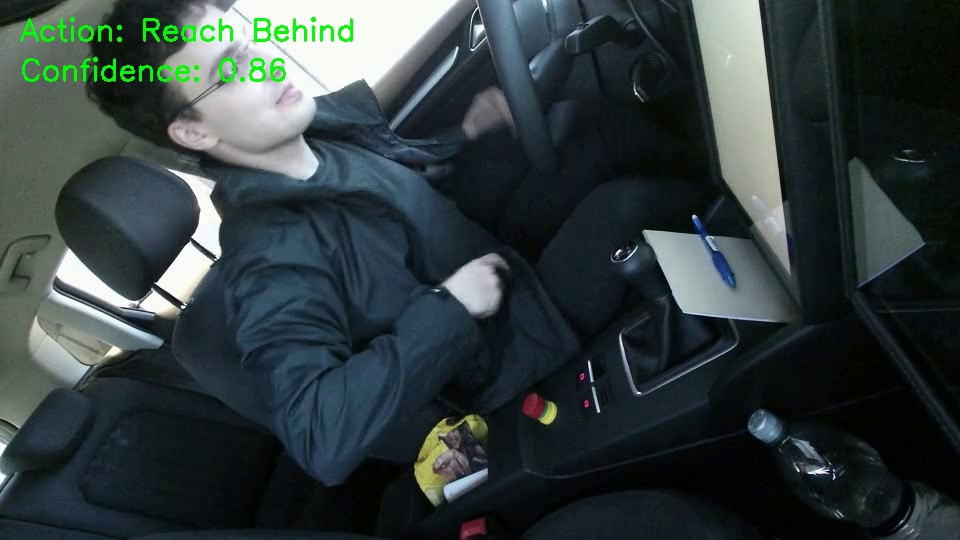
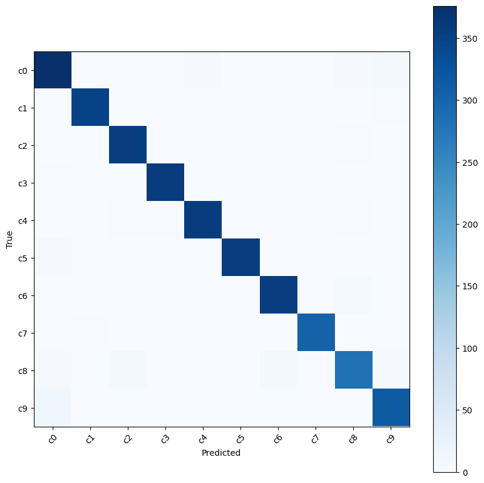
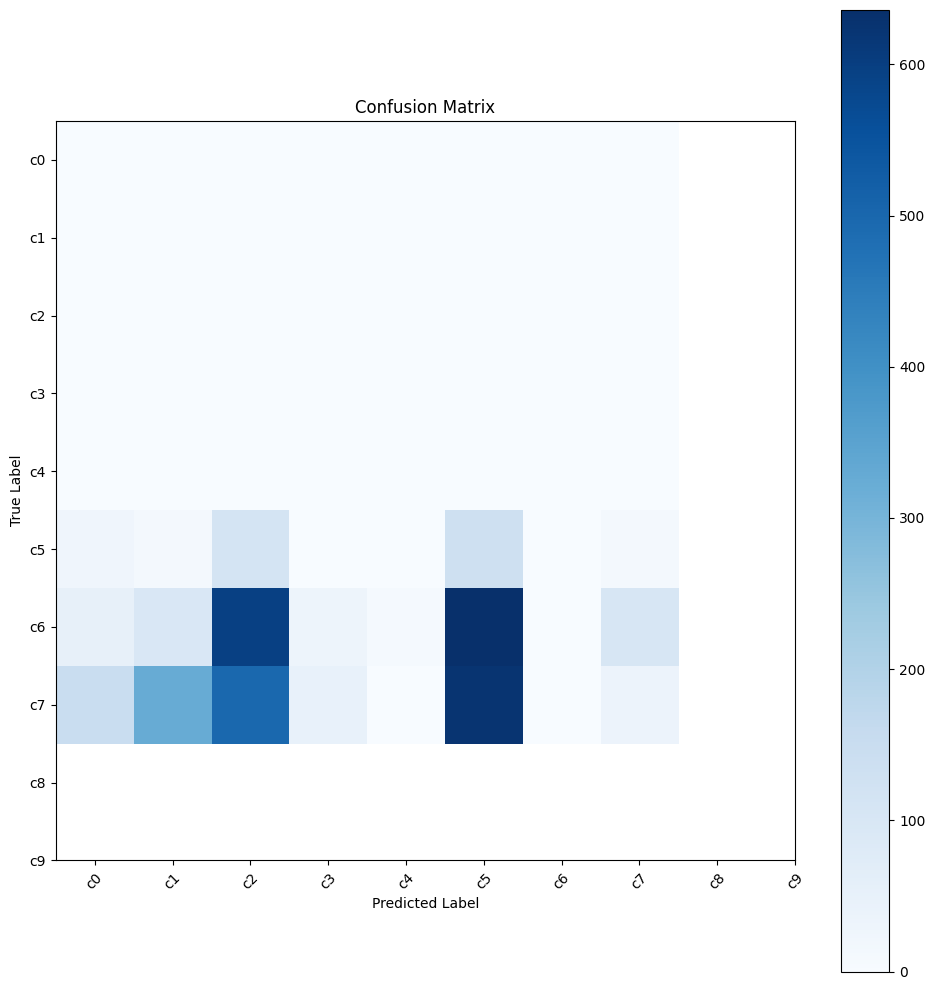
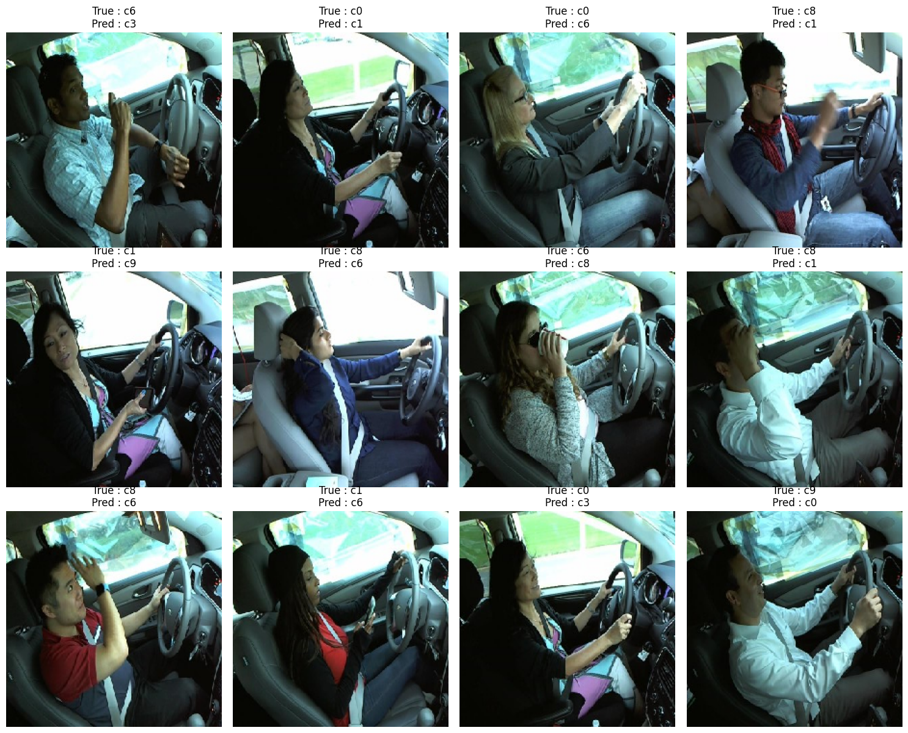

# Driver Distraction Detection

A deep learning model that detects distracted driving behavior from in-car camera images.
Built with **EfficientNetB0** transfer learning in **TensorFlow/Keras**. Developed during my internship at **Seyir Mobil** (July 2026).



## Results

| Stage | Validation accuracy |
|---|---|
| Feature extraction (frozen backbone) | 89.4% |
| Fine-tuning (last 30 layers unfrozen) | **97.5%** |

Macro F1 score: **0.975** on 3,493 validation images.



| Class | Behavior | Precision | Recall | F1 |
|---|---|---|---|---|
| c0 | Safe driving | 0.942 | 0.962 | 0.952 |
| c1 | Texting (right hand) | 0.992 | 0.994 | 0.993 |
| c2 | Talking on phone (right hand) | 0.970 | 0.992 | 0.981 |
| c3 | Texting (left hand) | 0.992 | 0.992 | 0.992 |
| c4 | Talking on phone (left hand) | 0.986 | 0.984 | 0.985 |
| c5 | Operating the radio | 0.997 | 0.986 | 0.992 |
| c6 | Drinking | 0.975 | 0.981 | 0.978 |
| c7 | Reaching behind | 0.984 | 0.990 | 0.987 |
| c8 | Hair and makeup | 0.953 | 0.931 | 0.942 |
| c9 | Talking to passenger | 0.960 | 0.935 | 0.947 |

The weakest classes are **c8 (hair and makeup)** and **c9 (talking to passenger)**. In both, the driver's hands are often near the face or the wheel, so they are easily confused with other classes.

## How it works

1. **Data.** [State Farm Distracted Driver Detection](https://www.kaggle.com/c/state-farm-distracted-driver-detection) dataset with 17,462 labeled images in 10 classes. A stratified 80/20 train/validation split keeps each class equally represented.
2. **Pipeline.** `tf.data` handles loading, resizing to 224x224, shuffling and prefetching.
3. **Augmentation.** Random flip, rotation, zoom and contrast.
4. **Model.** ImageNet-pretrained EfficientNetB0, followed by global average pooling and a softmax classifier.
5. **Training in two stages:**
   - The backbone stays frozen while only the classifier head is trained.
   - The last 30 layers are then unfrozen and trained with a lower learning rate. BatchNorm layers stay frozen.
6. **Regularization.** EarlyStopping, ReduceLROnPlateau and ModelCheckpoint.
7. **Video inference.** OpenCV reads a driving video and runs a prediction every 2 seconds. It writes the predicted action and its confidence onto each frame and produces an annotated output video.

## A bug I found along the way

The first training run reported 91% validation accuracy. That number was wrong. When I checked the class distribution, the validation set contained **only classes c7, c8 and c9**:

```
Class counts: [0 0 0 0 0 0 0 293 1518 1681]
```

The model was being evaluated on only 3 of the 10 classes, so the accuracy figure meant nothing. Instead of relying on the automatic split in `image_dataset_from_directory`, I listed every file path myself and split them with a stratified `train_test_split`, which puts every class in both sets in the right proportion. I then checked the class counts of both sets before training. All results above come from this corrected split.



## Limitations

- **Possible leakage from the random split.** The images in this dataset are frames from videos of the same drivers. A random split can put near-identical frames of one driver in both the training and validation sets. A split by driver (`driver_imgs_list.csv`) would give a more realistic estimate.
- **Lower confidence on new footage.** On real driving videos from the Drive&Act dataset, which uses a different camera angle and car interior, predictions are noticeably less confident. Moving from a benchmark to a new environment needs data from that environment. I started building a 6-class dataset from Drive&Act video annotations for this purpose.



## Repository structure

```
notebooks/
  01_training.ipynb          data loading, training, fine-tuning, evaluation
  02_video_inference.ipynb   running the trained model on a driving video
images/                      result figures
```

The dataset and the trained model are not included because of their size and the dataset licenses.

## Running

The notebooks are designed for **Google Colab** with a GPU runtime.

1. Download your `kaggle.json` API key from Kaggle and upload it to the Colab session.
2. Run `01_training.ipynb` to download the dataset and train the model.
3. Set `MODEL_PATH` and `VIDEO_PATH` in `02_video_inference.ipynb` and run it.

```
pip install -r requirements.txt
```

## Tech stack

Python · TensorFlow/Keras · EfficientNetB0 · OpenCV · scikit-learn · NumPy · Pandas · Matplotlib · Google Colab
